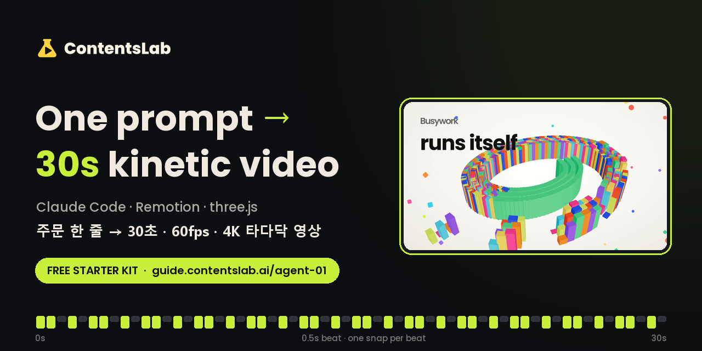
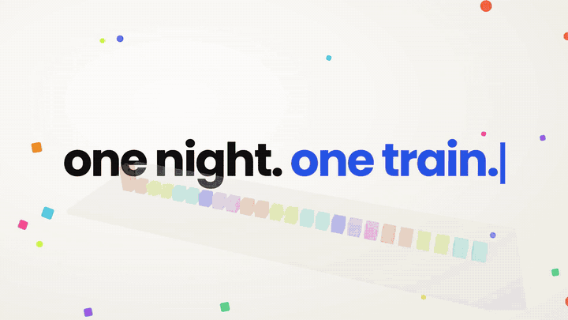
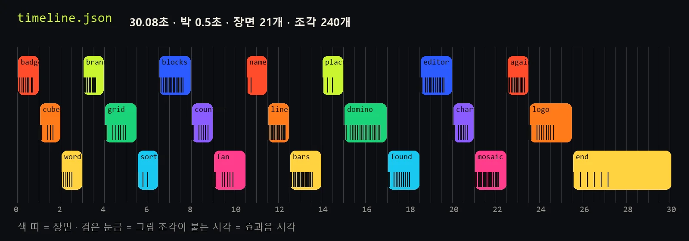
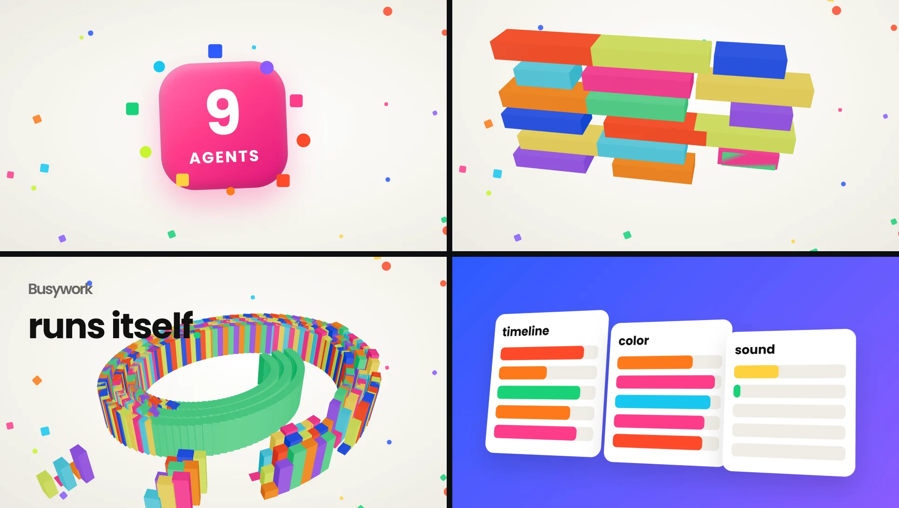
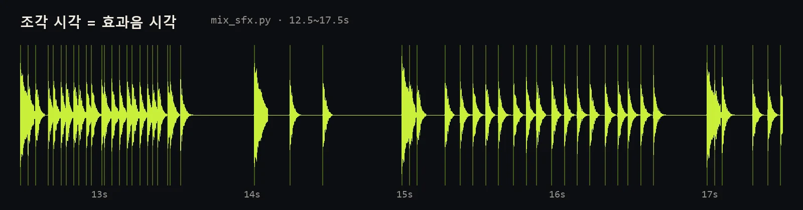
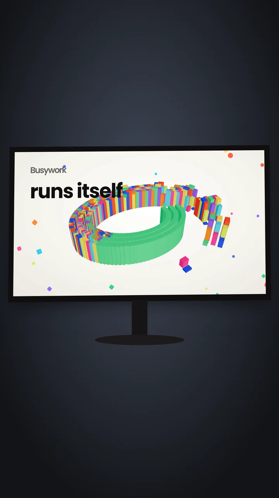
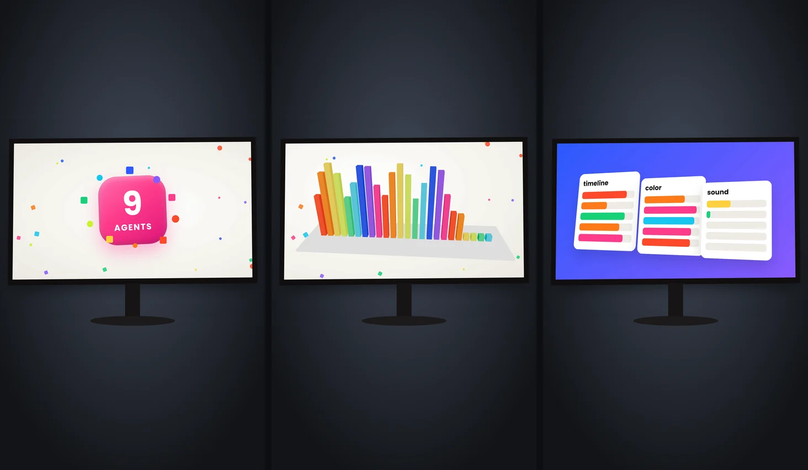

<p align="center">
  <a href="https://guide.contentslab.ai/agent-01?src=github"></a>
</p>

<p align="center">
  <a href="https://claude.com/claude-code"></a>
  <a href="https://www.remotion.dev"></a>
  <a href="https://threejs.org"></a>
  <a href="https://www.python.org"></a>
  <a href="https://nodejs.org"></a>
  <a href="#faq"></a>
</p>
<p align="center">
  <a href="https://guide.contentslab.ai/agent-01?src=github"></a>
  <a href="https://www.instagram.com/contentslab.ai/"></a>
  <a href="https://www.threads.com/@contentslab.ai"></a>
</p>

<p align="center">
  
  <br><sub>5-second preview (scaled down from the 4K 60fps cut · <a href="sample/out-preview.mp4">mp4 with sound</a>)</sub>
</p>

<p align="center"><b>Paste one prompt into Claude Code → an agent builds a 30-second, 60fps, 4K kinetic-type video.</b><br>
주문 한 줄만 붙이면 에이전트가 30초 · 60fps · 4K 키네틱 타이포 영상을 만들어요.</p>

<p align="center"><b><a href="#english">English</a> · <a href="#한국어">한국어</a></b></p>

---

## English

### Quick start

```bash
git clone https://github.com/contentslabai/one-prompt-30s-video.git
cd one-prompt-30s-video
npm i
```

You also need Node.js 20+ ([nodejs.org](https://nodejs.org)), Python 3.10+ with `pip install numpy opencv-python` ([python.org](https://www.python.org)), ffmpeg ([ffmpeg.org](https://ffmpeg.org/download.html)) and Claude Code ([claude.com/claude-code](https://claude.com/claude-code)).

Open the folder in Claude Code and paste this. Change only the two `<...>` slots.

```text
Following .claude/skills/kinetic-30s/SKILL.md in this folder, make a 30-second, 60fps kinetic typography video in Remotion where one piece snaps in on every 0.5-second beat. Topic: "<your topic>". Brand name on the last scene: "<your name>". Add a sound effect at every snap time and master the audio to -14 LUFS. When done, show me 6 stills at 1, 5, 10, 15, 20 and 25 seconds.
```

### The 5 steps (what the agent does)

**1. Scene table** — 30 s split into 0.5 s beats · 21 scenes · 240 pieces · `python scripts/gen_timeline.py` → `src/timeline.json`



**2. Motion graphics** — Remotion + three.js, every piece snaps in on its beat · `src/Viewer.tsx` (change `TEXT` at the top) · `npm run studio`



**3. Sound on the beat** — snap time = sound time (same table) · -14 LUFS · `python scripts/mix_sfx.py` (`--sfx folder` · `--music file`)



**4. Background** — put the screen inside a laptop / monitor shot · `python scripts/compose.py --bg bg.jpg --quad "x,y x,y x,y x,y"` (or `--demo`)



**5. Render · export** — 4K 60fps → Reels 1440×2560 · add sound · `npm run render` → `python scripts/mix_sfx.py --video out/viewer-4k.mp4` → `compose.py`



Quick test (about 3–10 min):

```bash
npm run still          # out/still.png  (one frame at 16 s)
npm run preview        # out/preview.mp4 (first 5 s, half size)
python scripts/mix_sfx.py
python scripts/compose.py --demo --screen out/preview.mp4 --seconds 5
```

### Free guide
The original, how it was made, the 5 steps with real timings and how to split the work between agents:
**→ https://guide.contentslab.ai/agent-01?src=github**

### Fonts (optional)
Font files are not included. Without them the default bold font is used. To match the video, create `public/fonts/` and add `Poppins-Bold.ttf` · `Poppins-SemiBold.ttf` ([Google Fonts](https://fonts.google.com/specimen/Poppins)) and `GmarketSansTTFBold.ttf` ([Gmarket Sans](https://corp.gmarket.com/fonts/)).

### Follow for the next kit
Every episode is a new 30-second video with its own kit.
- Instagram — [@contentslab.ai](https://www.instagram.com/contentslab.ai/)
- Threads — [@contentslab.ai](https://www.threads.com/@contentslab.ai)

---

## 한국어

### 바로 시작

```bash
git clone https://github.com/contentslabai/one-prompt-30s-video.git
cd one-prompt-30s-video
npm i
```

준비물: Node.js 20 이상([nodejs.org](https://nodejs.org)) · Python 3.10 이상 + `pip install numpy opencv-python`([python.org](https://www.python.org)) · ffmpeg([ffmpeg.org](https://ffmpeg.org/download.html)) · Claude Code([claude.com/claude-code](https://claude.com/claude-code)).

폴더를 Claude Code 로 열고 그대로 붙이세요. 「 」 안 두 칸만 내 것으로 바꾸면 돼요.

```text
이 폴더의 .claude/skills/kinetic-30s/SKILL.md 대로, 30초 · 60fps · 0.5초 박마다 조각이 하나씩 붙는 키네틱 타이포 영상을 Remotion으로 만들어 줘. 주제는 「여기에 내 주제」, 끝 장면 브랜드 이름은 「여기에 내 이름」. 조각이 붙는 시각마다 효과음을 넣고 소리는 -14 LUFS. 다 되면 1·5·10·15·20·25초 스틸 6장을 보여 줘.
```

### 5단계 (에이전트가 하는 일)

| 단계 | 하는 일 | 파일 · 명령 |
|---|---|---|
| 1. 장면 표 짜기 | 30초를 0.5초 박으로 · 장면 21개 · 조각 240개 | `python scripts/gen_timeline.py` → `src/timeline.json` |
| 2. 모션그래픽 | Remotion + three.js 로 조각이 「타다닥」 붙음 | `src/Viewer.tsx`(맨 위 `TEXT` 만 바꿔도 다른 영상) · `npm run studio` |
| 3. 소리 박자 | 조각이 붙는 시각 = 효과음 시각 · -14 LUFS | `python scripts/mix_sfx.py`(`--sfx 폴더` · `--music 파일`) |
| 4. 배경 합성 | 화면을 노트북 · 모니터 안에 넣기 | `python scripts/compose.py --bg 바탕.jpg --quad "x,y x,y x,y x,y"`(없으면 `--demo`) |
| 5. 렌더 · 내보내기 | 4K 60fps → 릴스 1440×2560 · 소리 얹기 | `npm run render` → `python scripts/mix_sfx.py --video out/viewer-4k.mp4` → `compose.py` |

단계마다 그림은 위 English 칸에 있어요. 빨리 한 번 돌려 보기(약 3~10분)도 위 네 줄과 같아요.

### 무료 가이드
원작 · 만든 길 · 걸린 시간까지 적은 자세한 5단계 · 에이전트에게 일을 나눠 맡기는 법:
**→ https://guide.contentslab.ai/agent-01?src=github**

### 글꼴 (선택)
글꼴 파일은 넣지 않았어요. 없으면 기본 굵은 글꼴로 그려져요. 영상과 같은 느낌을 원하면 `public/fonts/` 를 만들고 `Poppins-Bold.ttf` · `Poppins-SemiBold.ttf`([Google Fonts](https://fonts.google.com/specimen/Poppins)) · `GmarketSansTTFBold.ttf`([G마켓 산스](https://corp.gmarket.com/fonts/))를 넣으세요.

### 다음 키트 알림
매 편 다른 30초 영상과 그 영상의 새 키트를 드려요.
- 인스타그램 — [@contentslab.ai](https://www.instagram.com/contentslab.ai/)
- 스레드 — [@contentslab.ai](https://www.threads.com/@contentslab.ai)

---

## FAQ

- **사양 · Hardware?** 그래픽카드 없는 노트북도 돼요. 4K 30초 렌더는 보통 10~30분 · A laptop without a GPU works; a 4K 30 s render takes about 10–30 min. Test with `npm run preview`.
- **상업적으로 · Commercial use?** 이 저장소의 코드 · 글은 자유롭게 고쳐 쓰셔도 돼요. 글꼴 · 음악 · 효과음 · 바탕 영상은 각자 받은 곳의 약관을 따르세요 · Code and text here are free to modify and use; fonts, music, sound effects and background footage follow their own licenses.
- **3D 장면이 검게 나와요 · 3D scene is black.** `remotion.config.ts` 의 `setChromiumOpenGlRenderer('angle')` 를 지우지 마세요(윈도우 WebGL) · Keep `setChromiumOpenGlRenderer('angle')` in `remotion.config.ts` (Windows WebGL).

<sub>ContentsLab.ai · Made with Claude Code · Remotion · three.js</sub>
